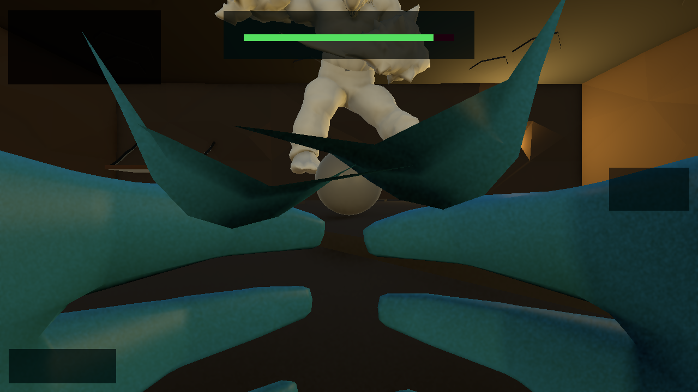
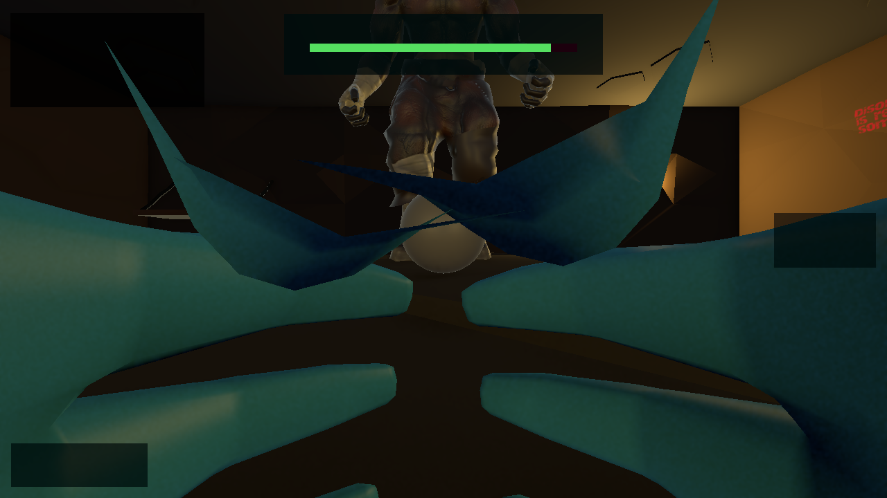

# VR Boss Fight

> A VR action game where you fight towering bosses with your controller-tracked fists. Developed for Meta Quest and PC VR.

**Screenshot status:** these are diagnostic batch-Editor captures without live XR tracking. Fallback hand poses can obscure the arena, and text/counters can be missing in the offscreen capture. The filenames reserve the intended showcase positions; they are not evidence of a fist spark, a critical hit, or readable performance measurements. Replace them with interactive XR simulator/Quest captures before using this README as a report or portfolio showcase.

## About

Step into a dungeon and fight the Mutant and Minotaur using punches and throwable energy orbs. The prison room was adapted from VRPuzzelGame; boss AI, hand combat, effects and HUD are original work by Yato.

Each boss has **50 HP**. A successful hand punch deals **5 damage**, so ten unblocked punches defeat a full-health boss. An orb impact deals **1 damage**, so fifty valid orb hits are needed if using only orbs. Mix punches and throws while dodging attacks.

The prison room scene is adapted from [VRPuzzelGame by Youkaku-1]. Boss AI, hand combat, effects and HUD are original work by Yato. Credit to Youkaku-1 applies specifically to the adapted prison room, not those gameplay systems.

## Features

- **Hand combat:** controller-tracked fist triggers, a default **1.0 m/s** velocity threshold, 5 damage and an independent 0.3-second cooldown per hand. Holding that hand's grip bypasses the velocity test. Physical optical hand-tracking support is not claimed.
- **Two boss arenas:** Mutant Behemoth in Level 2 and Minotaur Warlord in Level 4.
- **Boss attacks:** punches, swipes, roar/projectiles and jump/slam patterns, with additive telegraph effects and health bars.
- **Combat presentation:** hit particles, red flashes, short death slow motion, combo display and a critical callout during boss attacks. Critical callouts do not increase damage.
- **HUDs:** monitor HUD plus wrist health/combos and existing world-space boss bars.
- **Audio:** procedural placeholder impacts, growls, chimes, victory audio and ambience.
- **Performance panel:** **F3** displays frame-rate timing, profiler draw-call/triangle counters when available, active colliders and scene name. Batch timing is not a Quest benchmark.
- **Runtime setup:** presentation starts automatically; existing saved combat and scene progression remain in place.
- **Quest target:** OpenXR/XRI project targeting PC VR and Meta Quest. The latest polish has passed automated Editor smoke checks; interactive simulator, physical haptics and a fresh standalone Quest build still require verification.

## Controls

| Input | Action |
|---|---|
| Grip on either controller | Grab eligible objects / bypass that hand's punch velocity check |
| Swing a controller-tracked hand into the boss | Punch when fast enough; default threshold 1.0 m/s |
| Release a grabbed orb while swinging | Throw; collision/impact speed determines damage |
| Trigger | XR UI/interactor action according to the rig; not a dedicated orb-launch command |
| F3 on PC | Toggle performance overlay |

### Keyboard simulator bindings

The bundled **XR Interaction Simulator 3.3.1** action assets use these bindings. Focus the Game view and check the simulator's on-screen X/Y help because active action assets determine the final controls.

| Key | Bundled action |
|---|---|
| `[` / `]` | Toggle manipulation of left / right controller |
| H | Toggle head manipulation |
| Tab | Cycle manipulated device |
| W/A/S/D | Move the currently manipulated device |
| Q / E | Vertical movement; these are not grip bindings |
| G | Right controller grip action; Shift selects left device actions |
| Shift + G | Left controller grip action |
| T | Trigger action; Shift selects left device actions |
| Arrow keys | Rotation |
| R | Reset manipulated pose |
| X / Y | Toggle controller-actions / input-selection help |
| F3 | Performance overlay |

Keys 1 and 2 are controller primary/secondary buttons in the inspected action assets, not left/right device-selection shortcuts. No two-grip combination is required for the velocity bypass: each hand reads its own grip.

## How to Run

### In Unity Editor

1. Clone this repository with **Git LFS** installed, then run `git lfs pull`.
2. Open the project root in **Unity 6000.3.7f1** and allow UPM/asset import to finish.
3. Open **`Assets/Scenes/Main Menu.unity`**. There is no `00_MainMenu.unity` in this project.
4. Enable the project's XR simulator, focus the Game view and press Play.
5. To inspect an arena directly, open `Assets/Scenes/Level 2.unity` or `Assets/Scenes/Level 4.unity` and press Play.
6. Use the simulator's input-selection and controller-action help for the currently loaded bindings.

### In VR (Meta Quest)

1. Install the appropriate Unity Android modules for standalone Quest, or use Quest Link/Air Link with a compatible PC OpenXR runtime for PC VR.
2. In Unity 6 use **File → Build Profiles**. Select Windows for Link/PC VR, or Android for standalone Quest.
3. Verify OpenXR is enabled for the selected target and resolve XR Project Validation items. For Android verify the intended ARM64/IL2CPP and device settings.
4. Keep the existing enabled scene order, connect the device and use Build And Run.
5. Verify stereo rendering, both-hand punches, orb throws, haptics and scene progression on the headset. A new Quest build of the latest polish has not been verified here.

## Setup Bosses

Existing Unity Editor menu entries:

- **VR Boss → Boss 1 Setup (Level 2)**
- **VR Boss → Boss 2 Setup (Level 4)**

Each command repairs/configures its boss and saves the scene. Saved boss configuration and runtime presentation work without editor menu access in a build. Effects are created by the runtime polish layer, not by adding new setup menu entries.

## Tech Stack

- Unity 6.3 LTS — **6000.3.7f1**
- Universal Render Pipeline — **17.3.0**
- XR Interaction Toolkit — **3.3.1**
- OpenXR Plugin — **1.16.1**
- Input System — **1.18.0**
- XR Hands — **1.7.3**
- C# / project's Unity scripting profile
- Git LFS for binary and large assets

## Verification Status

Unity batch compilation completed successfully. Automated smoke checks loaded Main Menu, both boss arenas and End Screen; `BossHealth.TakeDamage(5)` reduced each boss from 50 to 45 HP and the controllers resumed after the entrance sequence. These checks do not prove physical punch contacts, headset haptics or a successful Quest build.

The project retains existing automatic scene progression: Level 2 proceeds to Level 3; Level 4 proceeds to End Screen. The intro animates UI instead of moving the protected XR camera. Death shake affects UI rather than headset pose. See [POLISH_NOTES.md](POLISH_NOTES.md).

## Repository Size

The source Assets tree is about **2.49 GB** uncompressed. Git LFS keeps large/binary content outside ordinary Git blobs. A Git repository below 500 MB does **not** imply a source checkout/LFS download below 500 MB. Fetching all assets requires sufficient LFS quota and disk space.

## Credits

- Prison room scene: adapted from [VRPuzzelGame by Youkaku-1](https://github.com/Youkaku-1/VRPuzzelGame)
- Boss AI, hand combat, effects, HUD: original work by Yato
- Mixamo — boss animations
- Unity — XR toolkit, OpenXR
- Meta — Quest platform

## License

[MIT](LICENSE) applies to **Yato's original contributions only**. It does not relicense the upstream project, third-party models, animations, textures, audio, fonts, samples or packages. See [THIRD_PARTY_NOTICES.md](THIRD_PARTY_NOTICES.md).

The prison room was adapted from VRPuzzelGame. The downloaded source README describes educational use, but no root license grant was found locally. Public redistribution permission for the adapted prison room and external asset packs is unverified. This handoff therefore creates a **private repository**. Do not advertise the whole project as MIT or make it public until those permissions have been established.
